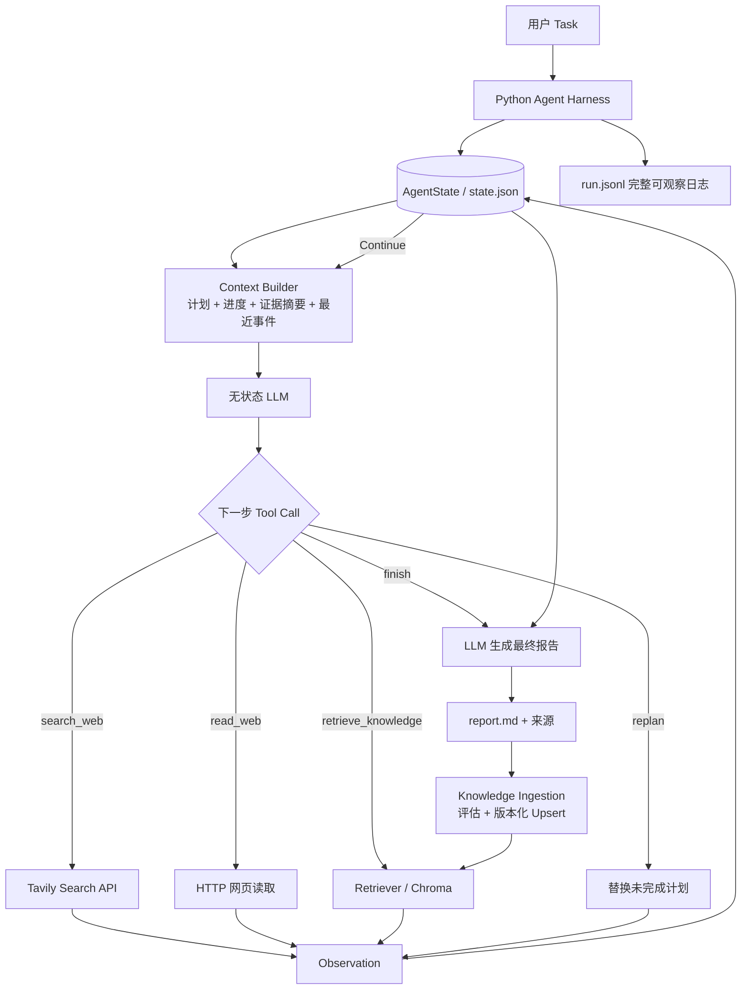

# 单 Agent 架构图

关键循环是 `State → Context → LLM → Action → Tool → Observation → State Update`。LLM 每次调用都是无状态的；持续执行、持久化、错误恢复、最大轮数和报告落盘都由 Python harness 负责。知识检索仍由 LLM 通过 Tool 自主触发；增量入库只在真实报告成功后执行，不进入 Agent Loop。
