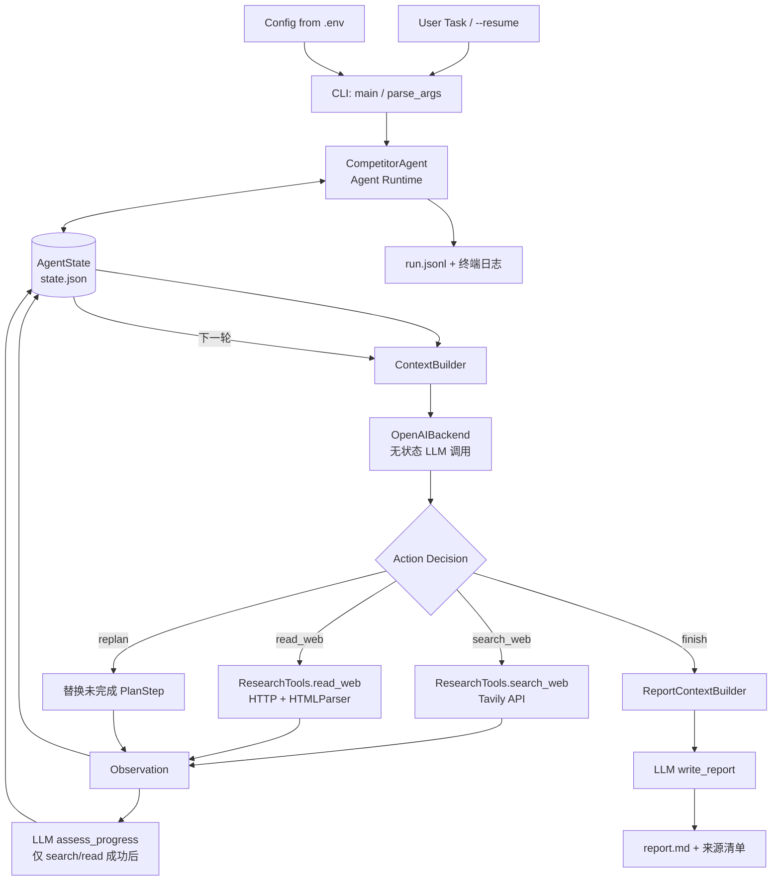
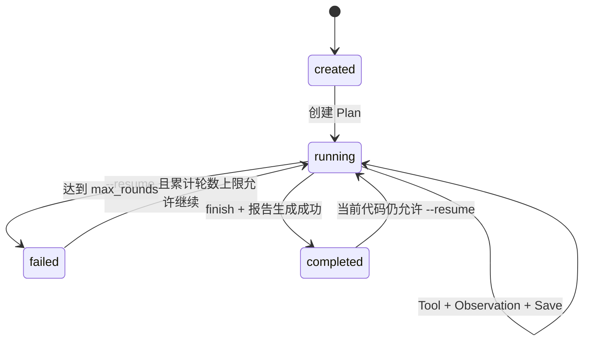
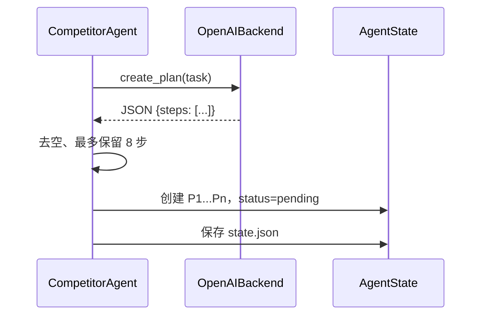

# 系统架构

## 1. 架构范围

当前系统是一个单进程、同步执行、单 Agent 的 Python CLI 应用。实现按配置、状态、Context、LLM、工具、日志和 Agent 编排职责拆分为普通 Python 模块，没有外部 Agent 编排框架。`main.py` 只负责 CLI 参数解析和依赖装配。

## 2. 总体流程



实际循环是：

```text
User Task
  → Agent Runtime
  → State
  → Context Builder
  → LLM Backend
  → Action Decision
  → Tool Execution
  → Observation
  → State Update
  → Continue / Replan / Finish
```

## 3. 模块结构与职责

```text
competitor-agent/
├── main.py
├── agent/
│   ├── __init__.py
│   ├── core.py
│   ├── state.py
│   └── context.py
├── llm/
│   ├── __init__.py
│   ├── backend.py
│   ├── openai_backend.py
│   └── prompts.py
├── tools/
│   ├── __init__.py
│   ├── schemas.py
│   ├── research.py
│   └── demo.py
├── config/
│   ├── __init__.py
│   └── settings.py
└── storage/
    ├── __init__.py
    └── logger.py
```

| 文件 | 类/对象 | 当前职责 |
|---|---|---|
| `main.py` | `parse_args`、`main` | 解析 CLI、创建 Config/LLM/Tools/State/Agent 并调用 `run()`；同时转发旧版公开导入名称 |
| `config/settings.py` | `Config` | 从 `.env` 读取模型、API Key、轮数、Context 预算和 HTTP 超时 |
| `agent/state.py` | `PlanStep`、`Source`、`AgentState` | 保存计划步骤、来源和最新可恢复状态，并负责 JSON 序列化 |
| `agent/context.py` | `ContextBuilder`、`ReportContextBuilder` | 将 State 转换为有限决策 Context 或较丰富的报告 Context，不调用 LLM |
| `agent/core.py` | `CompetitorAgent` | 编排组件，执行原有 Agent Loop、状态持久化和报告落盘 |
| `llm/backend.py` | `LLMBackend` | 规定 Planning、Decision、Progress、Replan、Report 五类 LLM 能力接口 |
| `llm/openai_backend.py` | `OpenAIBackend` | 使用 OpenAI SDK Chat Completions 实现 `LLMBackend` |
| `llm/prompts.py` | 提示词常量 | 集中保存 OpenAI 后端使用的五类提示词 |
| `tools/schemas.py` | `TOOL_SCHEMAS` | 保存四个 Function Calling Schema，不执行工具 |
| `tools/research.py` | `VisibleTextParser`、`ResearchTools` | 调用 Tavily 搜索，执行 URL 安全检查并读取公开网页 |
| `tools/demo.py` | `DemoLLMBackend`、`DemoResearchTools` | 提供固定动作脚本和 Alpha/Beta 离线网页夹具 |
| `storage/logger.py` | `RunLogger`、`utc_now`、`compact` | 将事件追加到 `run.jsonl`、输出压缩终端日志，并提供时间/压缩辅助函数 |
| 各目录 `__init__.py` | 包导出 | 声明 Python 包并导出主要公共类型 |

当前不存在 Scheduler、Planner 服务、Memory 服务、RAG 服务或 Multi-Agent Coordinator 等独立组件。

## 4. LLM 与 Agent Runtime 的职责区别

### 4.1 LLM 负责

- 把任务拆成研究步骤；
- 根据当前 Context 选择一个下一步 Action；
- 在工具成功后判断哪些步骤已有足够证据；
- 在重复保护触发时生成替代计划；
- 根据报告 Context 撰写最终报告。

### 4.2 Agent Runtime 负责

- 保管完整 State；
- 决定何时调用哪类 LLM 接口；
- 向模型暴露固定 Tool Schema；
- 执行真实搜索和网页请求；
- 将 Observation 转换为 Source 和状态变化；
- 实施 URL 安全检查、重复保护和最大轮数；
- 持久化状态、日志和报告。

LLM 不直接写文件，也不直接访问 Tavily 或网页。所有外部副作用都由 Runtime 的 Python 代码执行。

## 5. 为什么说 LLM 是无状态的

每次 `client.chat.completions.create()` 都只收到本次构造的 `messages`。代码没有复用服务端 conversation ID，也没有把完整对话历史原样发送给模型。

模型能“知道”前面发生了什么，是因为 Runtime 在下一轮从 `AgentState` 重新构造 Context，其中包含任务、计划、来源索引、有限证据和最近事件。如果删除 State 又不提供恢复文件，模型无法从之前的调用中自行恢复执行过程。

## 6. State 如何让 Agent 持续执行

`AgentState` 在内存中作为权威状态，并在关键节点写入 `state.json`：



上图最后一条是当前代码行为，不表示推荐工作流：代码没有阻止已完成状态再次恢复，所以真实日志中出现了重复生成报告的运行。

## 7. Context Management

### 7.1 `ContextBuilder`

决策 Context 默认限制为 14,000 字符：

- 保留全部来源的精简 `source_index`；
- 只放入预算允许的 `evidence`；
- 单个 Evidence 最多 1,800 字符；
- 优先“疑似官方”、已读取、更新时间较新的来源；
- 只包含最近 6 个压缩事件；
- 列出读取次数达到 2 次的 `blocked_urls`。

“疑似官方”是启发式标记，不是域名所有权校验。

### 7.2 `ReportContextBuilder`

报告 Context 默认限制为 70,000 字符：

- `source_catalog` 列出全部来源；
- `primary_evidence` 放已读取的正文；
- 相同正文按 SHA-256 去重；
- 来源按基础域名分组并轮换加入；
- 单个正文最多 7,000 字符；
- 剩余预算用于 `supplemental_evidence` 搜索摘要，每项最多 900 字符。

这两个 Builder 都直接操作普通 Python 字典，没有向量检索、语义检索或 Context 数据库。

## 8. Tool Calling 如何工作

`TOOL_SCHEMAS` 将四种 Action 作为 function schema 发送给 LLM。`OpenAIBackend.decide()` 设置 `tool_choice="required"`，读取第一条 Tool Call，并转换为：

```json
{
  "name": "search_web",
  "arguments": {
    "query": "...",
    "purpose": "...",
    "target_step_id": "P1"
  }
}
```

`CompetitorAgent._execute()` 按 `name` 分支执行。当前不支持模型在一轮返回多个工具调用，也没有通用插件发现机制。

### 8.1 搜索

`ResearchTools.search_web()` 向 `https://api.tavily.com/search` 发 POST 请求，固定使用 `search_depth="advanced"`，默认取 5 条，内部上限 8 条，不请求 Tavily answer 或 raw content。

### 8.2 网页读取

`ResearchTools.read_web()`：

1. 解析 URL 并限制为 HTTP(S)；
2. DNS 解析主机，拒绝非公网 IP；
3. 使用 `urllib.request` 请求最多 2 MB；
4. 对 HTML 使用 `VisibleTextParser` 提取文本；
5. 规范空白并截断到 50,000 字符。

当前没有浏览器引擎或 JavaScript 执行。

## 9. Planning 如何生成

新任务且 `state.plan` 为空时：



提示词要求 3–6 步，但 Python 接收上限是 8；代码没有强制最少 3 步。

## 10. Replan 如何触发

### 10.1 模型主动触发

模型在每轮可选择 `replan`，提供原因和至少一个新步骤。Runtime 不自行判断原因是否成立。

### 10.2 重复动作保护触发

搜索查询经小写和空白规范化，读取 URL 去掉 fragment、尾部斜杠并小写。相同签名最多实际执行 2 次；第三次会被阻止。累计重复计数达到 2 后，Runtime 调用 `revise_plan()` 生成替代未完成步骤。

Replan 只保留已完成步骤，不保留被替换的 pending 步骤到当前 Plan；变更历史保存在日志中。

## 11. Finish 与报告生成

模型选择 `finish` 后：

1. Runtime 检查至少有一个 Source；
2. 更新模型声明完成的步骤；
3. 退出 Agent Loop；
4. 构造 Report Context；
5. 调用 LLM 写报告；
6. 追加全部来源 Markdown 列表；
7. 写 `report.md`，更新 State 并记录完成日志。

报告生成不是另一个 Agent，也没有独立的审稿循环。

## 12. 配置与依赖

`.env.example` 对应 `Config.from_env()`：

| 环境变量 | 默认值/作用 |
|---|---|
| `LLM_API_KEY` 或 `OPENAI_API_KEY` | 真实模式必需 |
| `LLM_MODEL` | `gpt-4.1-mini` |
| `LLM_BASE_URL` | 可选 OpenAI 兼容服务地址 |
| `TAVILY_API_KEY` | 真实搜索必需 |
| `MAX_ROUNDS` | `12` |
| `CONTEXT_CHAR_BUDGET` | `14000` |
| `REPORT_CONTEXT_CHAR_BUDGET` | `70000` |
| `HTTP_TIMEOUT` | `20` 秒 |

第三方 Python 依赖只有 `openai` 和 `python-dotenv`；搜索和网页读取使用标准库 `urllib`。

## 13. 当前部署形态与边界

- 单机 CLI、同步执行；
- State 使用本地 JSON 文件，没有数据库事务或并发写保护；
- Log 使用本地 JSONL 追加，没有集中式日志系统；
- JSONL 没有代码版本和单次 CLI invocation ID，且 `progress_assessment` 事件本身不含轮次字段；
- 没有服务端 API、Web UI、鉴权或多租户隔离；
- 没有异步 Worker 或分布式执行；
- 没有长期 Memory、RAG 或 Multi-Agent。

上述均可作为未来扩展方向，但不属于当前架构。
